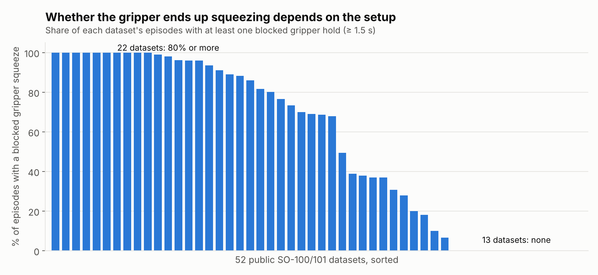
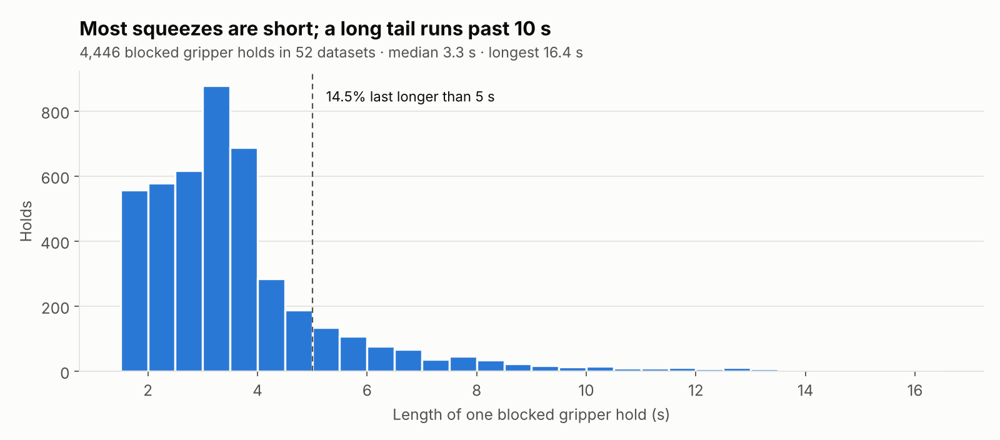
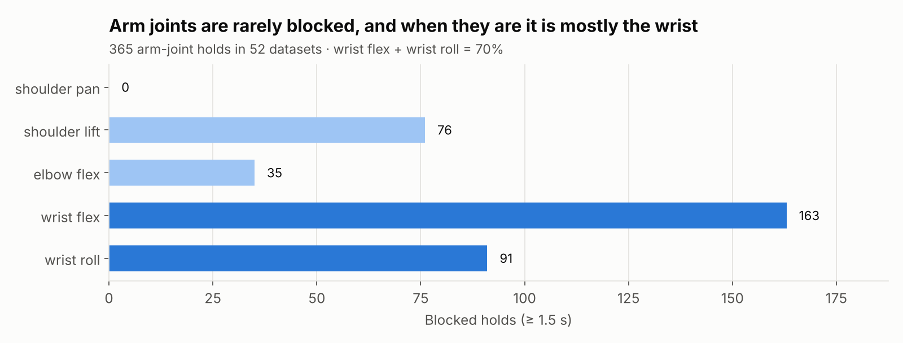
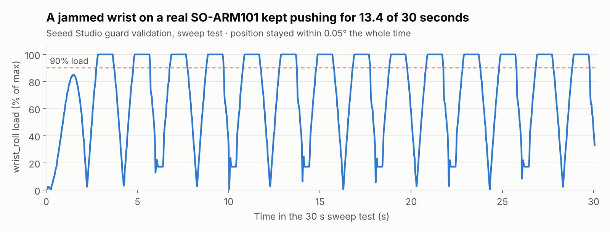

# What 32 hours of public SO-101 data say about blocked servos

*I'm a high school student, and this is an independent side project. The tool used here, bringup-check, is open source (MIT) and free. Nothing here is for sale.*

## TL;DR

- I scanned **52 public SO-100/SO-101 datasets** on the Hub: **7,533 episodes, about 32 hours** of teleoperation.
- **51% of episodes** contain at least one moment where the follower's gripper was commanded to close further but stayed put for 1.5 s or more. In other words, it was squeezing something. This happens in 39 of the 52 datasets.
- Arm joints are rarely blocked (3.5% of episodes). When they are, **70% of the time it's the wrist**.
- Datasets don't record load, so I also looked at one real arm. In Seeed Studio's test, a **jammed wrist_roll spent 13.4 of 30 seconds above 90% load**, while its position stayed within 0.05°.

## Why look at datasets at all

Every LeRobot teleoperation dataset stores two things per frame: what the leader commanded (`action`) and where the follower actually was (`observation.state`). Normally the two track each other closely. When a follower joint is blocked, say the gripper is already closed on an object or the wrist is pressed against the table, the command keeps asking for more while the joint doesn't move.

That gap is visible in recorded data, with no robot needed. A lot of SO-101 data is already public on the Hub, so we can ask a question that is hard to answer from forum posts alone: **how often does a follower spend time pushing against something?**

## Method

- **Datasets:** 52 public SO-100/SO-101 datasets, picked to cover different tasks and teams ([list](https://github.com/bluvtx09/bringup-check/blob/main/studies/public_datasets.txt)). The list originally had 53, but one turned out to be a trimmed copy of another, so I removed it.
- **What counts as a blocked hold:** the gap between command and position is at least 5 units for the gripper or 8 for an arm joint, the joint is nearly still, and this lasts at least 1.5 s. These are the same conditions the overload guard in bringup-check uses.
- **Units:** 26 datasets store degrees and 26 store LeRobot's normalized range, and I used the same thresholds for both. Treat the numbers as approximate.
- **What was downloaded:** only `meta/info.json` and the parquet files, no videos.

You can reproduce everything with one command (see the end of this post).

## Finding 1: gripper squeezes are routine, but depend heavily on the setup



Across all episodes, 51% contain at least one blocked gripper hold. The average hides a split, though:

- **22 datasets:** 80% or more of episodes have a hold.
- **13 datasets:** none at all.

Same robot, very different behavior. My guess is that it comes down to how the leader gripper is calibrated relative to the follower, and how hard operators habitually squeeze. I haven't verified this. If you recognize your dataset on either end, I'd love to hear what your setup looks like.

## Finding 2: most squeezes are short, with a long tail



The median hold is 3.3 s. 14.5% last longer than 5 s, 87 last longer than 10 s, and the longest is 16.4 s. In total, followers in these datasets spent about 4.5 hours squeezing.

## Finding 3: arm joints are rarely blocked, and when they are it's mostly the wrist



Only 3.5% of episodes (264) have a blocked arm joint, and they come from 14 datasets. Of 365 arm-joint holds, wrist flex and wrist roll account for 70%.

One caution here. A wrist_roll "hold" with a large gap may not be physical contact at all. It can also be a calibration problem, for example a joint whose range crosses the encoder's wrap point (see [lerobot#5324](https://github.com/huggingface/lerobot/issues/5324) for a related bug). Position data alone can't tell these apart, so check the video before drawing conclusions.

Separately, the scan flagged **8 joints in 6 datasets** where the follower sits off the leader for an entire episode. That pattern looks more like a leader/follower calibration mismatch than a block.

## What datasets can't tell you: load

A blocked hold in a dataset is a candidate, not proof that a servo strained. Datasets record position but not load or temperature. To see what blocking looks like in load, here is one real arm.

Seeed Studio kindly ran bringup-check's guard validation on an SO-ARM101 (LeRobot 0.4.4, Jetson). In the sweep test, the wrist_roll joint turned out to be jammed:



- Its position stayed within 0.05° for the whole 30 seconds.
- It kept hitting 100% load and spent **13.4 s above 90%**.
- The guard was running in that test. It backed off 7 times, but each time it handed control back, the sweep pushed the joint into the jam again. You can see that as the repeating peaks.

That failure is why the guard now has jammed-joint detection. A joint that is blocked in both directions at the same spot is held within ±2° until it moves again. Seeed later re-ran the validation with that version on two SO-ARM101 arms: the sweep, a stretched-out hold and a blocked wrist passed on both, and the wrist backed off after 4.0 s. Neither arm was jammed this time, so the jam check itself still hasn't fired on real hardware.

The gripper turned out differently, and the reason is worth knowing if you work with SO-101 data. Even with a rigid object, the gripper load peaked near 50% and then settled around 20% while the jaws stayed far from the command. That is not the guard. LeRobot's SO follower driver configures the gripper servo itself: a maximum torque of 50%, and 25% once the servo detects an overload. So the gripper already protects itself, and a blocked gripper squeeze in a dataset is probably a light one once the servo's own protection has kicked in, which took a few seconds in Seeed's log. Where the gap still matters is the data: the recorded command keeps saying "close further" while the jaws can't, and a policy trained on it learns that command.

## Limitations

- **Curated data:** public datasets are mostly recorded by experienced users and then cleaned up, so they probably understate what happens in a first teleoperation session.
- **Shared thresholds:** the same thresholds are applied to degree and normalized datasets.
- **Position only:** a "hold" means the follower didn't move while commanded to. It doesn't mean high load.
- **Few arms:** the load evidence comes from a few real arms, all at one company, which is not enough to set thresholds.

## Try it on your own dataset

```bash
pip install "bringup-check[dataset] @ git+https://github.com/bluvtx09/bringup-check"
bringup-check --scan-dataset your-name/your-dataset
```

This needs git for now (a PyPI release is on the to-do list). It works on any LeRobot dataset id or local folder. It lists per joint how often and how long the follower was blocked, and names the longest holds by episode and time so you can find them in the video.

If you have an SO-101, the guard runs as a drop-in robot type (`so101_follower_guarded`) and can log load per cycle. One more real-arm log would help more than anything else; please attach it to an issue.

## Thanks

Thanks to Seeed Studio for running the hardware tests on their SO-ARM101 arms and reporting a bug in the validation script, and to everyone who published the datasets listed above.

Code, scanner and raw results: [github.com/bluvtx09/bringup-check](https://github.com/bluvtx09/bringup-check)
